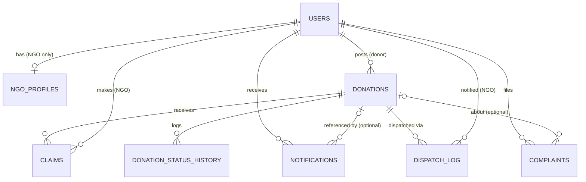
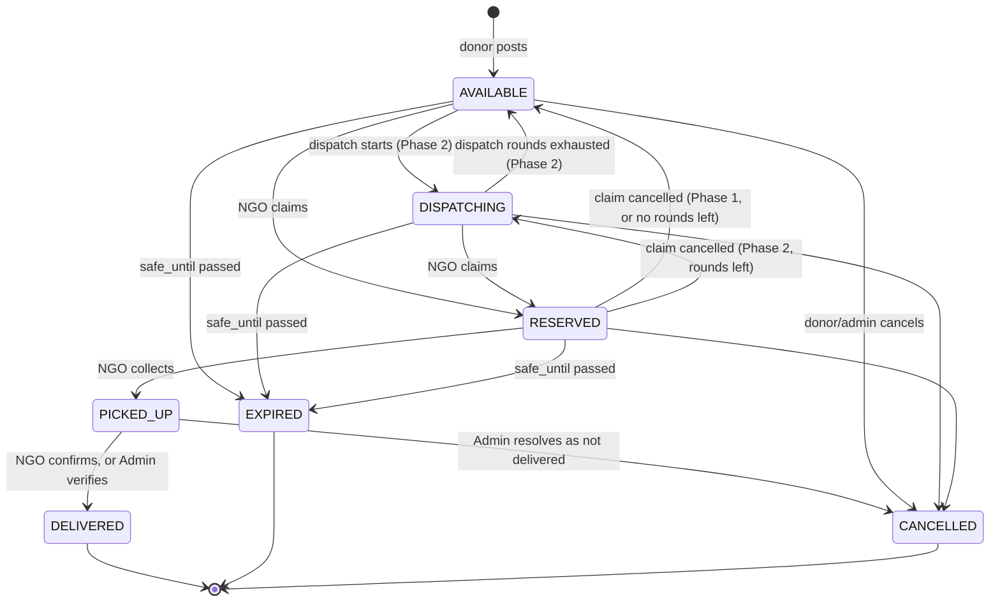
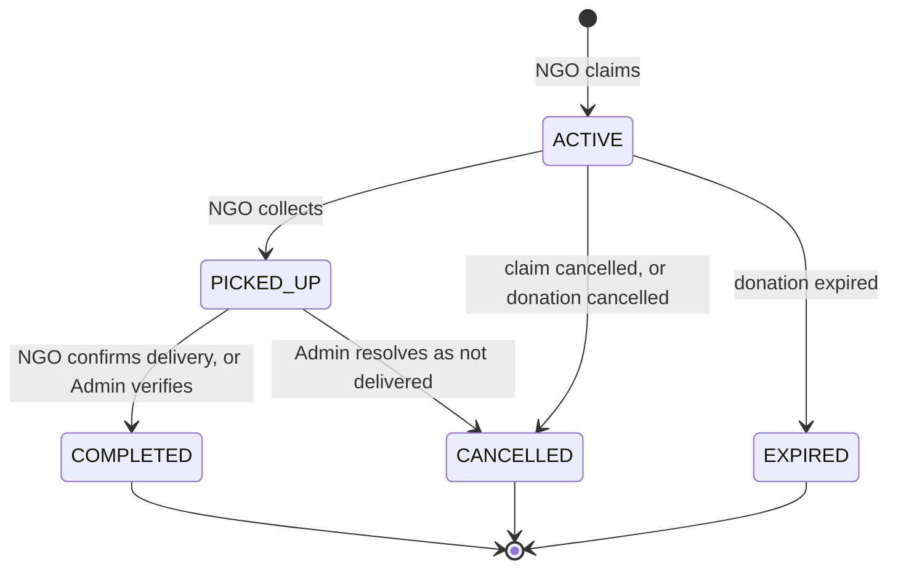
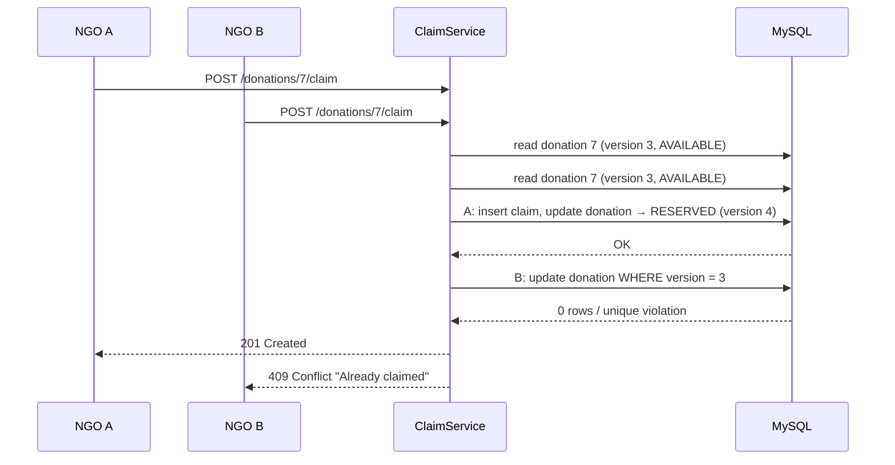

# Architecture

**Project:** Time-Sensitive Surplus Food Rescue

This document covers the system structure, data model, donation lifecycle and the key design decisions.

---

## 1. Style: layered monolith

One Spring Boot application serves both the REST API and the static frontend. Microservices would be over-engineering for this scope.

```
┌────────────────────────────────────────────────┐
│  Browser: HTML + CSS + JS + Bootstrap          │
└───────────────────────┬────────────────────────┘
                        │ REST (JSON), session cookie
┌───────────────────────▼────────────────────────┐
│  Security filter chain (Spring Security)       │
├────────────────────────────────────────────────┤
│  Controller layer   → validation, DTO mapping  │
├────────────────────────────────────────────────┤
│  Service layer      → business rules           │
│    AuthService        DonationService          │
│    ClaimService       FeedService              │
│    DispatchService*   NotificationService*     │
│    DashboardService   ComplaintService*        │
├────────────────────────────────────────────────┤
│  Algorithm package  → plain Java, no Spring    │
│    UrgencyScoreCalculator                      │
│    MatchScoreCalculator*                       │
│    DistanceUtil (Haversine)                    │
├────────────────────────────────────────────────┤
│  Scheduler          → ExpiryMonitor,           │
│                       DispatchScheduler*       │
├────────────────────────────────────────────────┤
│  Repository layer   → Spring Data JPA          │
└───────────────────────┬────────────────────────┘
                        │ Hibernate
                  ┌─────▼─────┐
                  │  MySQL 8  │
                  └───────────┘

* = Phase 2
```

**Rule:** controllers never touch repositories; services never touch HTTP objects; calculators know nothing about Spring or the database (so they are trivially unit-testable).

## 2. Package structure

```
com.foodrescue
├── config/        SecurityConfig, SchedulingConfig, ScoringProperties, DataSeeder
├── controller/    AuthController, DonationController, ClaimController,
│                  NgoProfileController, DashboardController, AdminController,
│                  NotificationController*, ComplaintController*
├── dto/           request and response records
├── entity/        User, NgoProfile, Donation, Claim, DonationStatusHistory,
│                  Notification*, DispatchLog*, Complaint*
├── enums/         Role, FoodCategory, DonationStatus, ClaimStatus
├── exception/     ResourceNotFoundException, DonationNotClaimableException,
│                  NgoNotEligibleException, InvalidStatusTransitionException,
│                  GlobalExceptionHandler
├── repository/    one per entity
├── service/       business logic
├── algorithm/     UrgencyScoreCalculator, MatchScoreCalculator*, DistanceUtil
└── scheduler/     ExpiryMonitor, DispatchScheduler*
```

## 3. Data model

### 3.1 ERD



`notifications.donation_id` and `complaints.donation_id` are nullable: a notification or complaint may be about one donation or about none (for example, a general complaint).

### 3.2 Tables

**users**
| Column | Type | Notes |
|---|---|---|
| id | BIGINT PK | auto-increment |
| name | VARCHAR(100) | person or organization name |
| email | VARCHAR(150) | **unique** |
| password_hash | VARCHAR(100) | BCrypt |
| role | ENUM | `DONOR`, `NGO`, `ADMIN` |
| phone | VARCHAR(20) | |
| address | VARCHAR(255) | |
| latitude, longitude | DOUBLE | default location; **required for NGO users** (the feed filters by distance from it), optional for donors (used as the default donation location) |
| active | BOOLEAN | admin can deactivate |
| created_at | DATETIME (UTC) | |

**ngo_profiles** (one per NGO user)
| Column | Type | Notes |
|---|---|---|
| id | BIGINT PK | |
| user_id | BIGINT FK | **unique** |
| capacity_meals | INT | nominal maximum meals the NGO takes in a single pickup; informational guideline to display warnings if exceeded and used for match scoring, NOT a hard claim disqualifier |
| service_radius_km | DOUBLE | |
| accepted_categories | VARCHAR | comma-separated `FoodCategory` values |
| total_claims | INT | for reliability; counting rules in §4 (claim lifecycle) and `ALGORITHMS.md` §3.2 |
| completed_claims | INT | for reliability; +1 when a claim becomes `COMPLETED` |

**donations**
| Column | Type | Notes |
|---|---|---|
| id | BIGINT PK | |
| donor_id | BIGINT FK → users | |
| food_name | VARCHAR(100) | |
| category | ENUM | `COOKED_MEAL`, `BAKERY`, `FRESH_PRODUCE`, `PACKAGED` |
| quantity | INT | meals / packets |
| description | VARCHAR(500) | optional |
| pickup_address | VARCHAR(255) | |
| latitude, longitude | DOUBLE | **NOT NULL**. Taken from the request, or copied from the donor's saved location at creation. Creation is rejected (400) if neither is available, so every donation can be used for distance checks |
| ready_from | DATETIME (UTC) | |
| safe_until | DATETIME (UTC) | hard deadline |
| status | ENUM | see §4 |
| dispatch_round | INT | 0 = not started (Phase 2) |
| round_ends_at | DATETIME | when the current round times out (Phase 2) |
| **version** | BIGINT | `@Version`, optimistic locking |
| created_at, updated_at | DATETIME | |

> The urgency score is **not stored**. It changes every minute as time runs out, so it is computed at read time (see `ALGORITHMS.md`).

**claims**
| Column | Type | Notes |
|---|---|---|
| id | BIGINT PK | |
| donation_id | BIGINT FK | |
| ngo_id | BIGINT FK → users | |
| status | ENUM | `ACTIVE`, `PICKED_UP`, `COMPLETED`, `CANCELLED`, `EXPIRED` (see §4, claim lifecycle) |
| **active_donation_id** | BIGINT **UNIQUE, nullable** | set to `donation_id` while the claim is `ACTIVE`, `PICKED_UP` or `COMPLETED`; `NULL` when `CANCELLED` or `EXPIRED` |
| claimed_at, picked_up_at, delivered_at, cancelled_at | DATETIME | `cancelled_at` is set only for `CANCELLED` claims. An `EXPIRED` claim needs no extra column: the expiry is recorded in `donation_status_history` |
| cancel_reason | VARCHAR(255) | user's reason, or a system reason such as "Donation cancelled by donor" or "NGO account deactivated" |

**donation_status_history**
`id, donation_id, from_status, to_status, changed_by (user id, null for system), note, changed_at`

**notifications** (Phase 2)
`id, user_id, donation_id (nullable), type, message, is_read, created_at`

**dispatch_log** (Phase 2)
`id, donation_id, ngo_id, round, notified_at`. Remembers who was already notified so a resumed dispatch never re-notifies the same NGO.

**complaints** (Phase 2)
`id, filed_by, donation_id (nullable), subject, description, status (OPEN/RESOLVED), created_at, resolved_by, resolved_at`

### 3.3 Indexes

| Index | Why |
|---|---|
| `users(email)` unique | login, duplicate-email prevention |
| `donations(status, safe_until)` | feed query and expiry job |
| `claims(active_donation_id)` unique | database-level duplicate-claim guard |
| `claims(ngo_id, status)` | "my claims" |
| `notifications(user_id, is_read)` | unread badge |

## 4. Donation lifecycle (state machine)



`DISPATCHING` exists in the enum from day one but is only used in Phase 2. In Phase 1, donations go `AVAILABLE → RESERVED` directly. `DISPATCHING` means "NGOs have been notified and another dispatch round or response window is still scheduled". Once the rounds are exhausted, the donation returns to `AVAILABLE` (`ALGORITHMS.md` §4.2).

**Reopen rule** (used whenever a reserved donation reopens after a claim is cancelled): Phase 1 → `AVAILABLE`. Phase 2 → `DISPATCHING` if `dispatch_round < maxRounds` (dispatch resumes), otherwise `AVAILABLE`.

### Allowed transitions and who may trigger them

| From → To | Triggered by |
|---|---|
| AVAILABLE → RESERVED | NGO (claim) |
| AVAILABLE → DISPATCHING | System (Phase 2) |
| DISPATCHING → AVAILABLE | System, when the last dispatch round's window ends unclaimed (Phase 2) |
| DISPATCHING → RESERVED | NGO (claim) |
| RESERVED → AVAILABLE / DISPATCHING (reopen rule) | NGO (cancel own claim), Admin (cancel claim), or System when Admin deactivates the NGO |
| RESERVED → PICKED_UP | NGO that holds the claim |
| PICKED_UP → DELIVERED | NGO that holds the claim, or Admin after verifying delivery (resolve) |
| PICKED_UP → CANCELLED | Admin only, when delivery did not happen or cannot be verified (resolve) |
| AVAILABLE / DISPATCHING / RESERVED → EXPIRED | System (expiry monitor) |
| AVAILABLE / DISPATCHING / RESERVED → CANCELLED | Donor (own), Admin, or System when Admin deactivates the donor |

A `PICKED_UP` donation never goes back to a claimable state. Once food has left the donor, it is never offered to another NGO.

Claimable states: `AVAILABLE`, `DISPATCHING`. Terminal states: `DELIVERED`, `EXPIRED`, `CANCELLED`.

**Phase 1 scope:** Phase 1 implements the NGO and System transitions only (claim, NGO cancel of own claim, pickup, deliver, expiry). Transitions triggered by a Donor cancel, by an Admin (cancel, resolve) or by deactivation are Phase 2, and so are the reliability counter updates in the claim lifecycle table below.

All transition logic lives in **one place** (`DonationService.changeStatus(...)`), which validates the move, writes the history row and throws `InvalidStatusTransitionException` for illegal moves. Nothing else may set `status` directly. When a donation moves to `EXPIRED` or `CANCELLED`, `changeStatus` also closes its active claim (see below) in the same transaction.

### Claim lifecycle

A claim's status always changes **together with** its donation's status, in the same transaction.



| Claim | Donation | Triggered by | Reliability effect (`ALGORITHMS.md` §3.2) |
|---|---|---|---|
| (new) → ACTIVE | AVAILABLE / DISPATCHING → RESERVED | NGO (claim) | `total_claims` +1 |
| ACTIVE → PICKED_UP | RESERVED → PICKED_UP | NGO that holds the claim | none |
| PICKED_UP → COMPLETED | PICKED_UP → DELIVERED | NGO that holds the claim, or Admin resolve (`DELIVERED`) | `completed_claims` +1 |
| PICKED_UP → CANCELLED | PICKED_UP → CANCELLED | Admin resolve (`NOT_DELIVERED`) | counts as not completed |
| ACTIVE → CANCELLED (*claim* cancelled) | RESERVED → reopen rule (above) | NGO (own), Admin, or System when the NGO is deactivated | counts as not completed |
| ACTIVE → CANCELLED (*donation* cancelled) | RESERVED → CANCELLED | Donor, Admin, or System when the donor is deactivated | `total_claims` −1 (not counted) |
| ACTIVE → EXPIRED | RESERVED → EXPIRED | System (expiry monitor) | counts as not completed |

Rules:
- Terminal claim states: `COMPLETED`, `CANCELLED`, `EXPIRED`.
- A `PICKED_UP` claim cannot be cancelled through the normal cancel endpoint, and it does not expire. The NGO has the food and must mark it delivered. If it never does (including when the NGO has been deactivated), an Admin resolves it (below).
- `active_donation_id` is set to `NULL` when a claim becomes `CANCELLED` or `EXPIRED`.
- The NGO's claim cancel and the Admin's claim cancel are the same operation (`PATCH /claims/{id}/cancel`). An Admin usually steps in because the NGO cannot complete the pickup, so it counts against the NGO like an NGO cancellation.

### Resolving stuck picked-up claims (Admin, Phase 2)

A claim is **stuck** when it is `PICKED_UP` and its donation's `safe_until` has passed. Admin finds these with `GET /admin/donations?status=PICKED_UP`; each row includes the claim and its `pickedUpAt`. Admin checks with the NGO and donor outside the platform (phone or email), then calls `PATCH /admin/claims/{id}/resolve` with a required `reason`:

| Outcome | When | Claim | Donation | Reliability |
|---|---|---|---|---|
| `DELIVERED` | Admin has verified the food reached recipients | → `COMPLETED` (`delivered_at` = now) | → `DELIVERED` (counts as rescued) | `completed_claims` +1 |
| `NOT_DELIVERED` | Delivery did not happen or cannot be verified | → `CANCELLED` (`cancel_reason` = reason, `active_donation_id` → `NULL`) | → `CANCELLED` (terminal; **never reopened**) | counts as not completed |

- Allowed only when the claim is `PICKED_UP` (otherwise 400). Works whether or not the NGO is still active.
- The action is recorded in `donation_status_history` with `changed_by` = Admin and `note` = "Admin resolution: <reason>". No new table or column is needed.
- No automatic timeout: resolution is always a deliberate Admin action.
- `NOT_DELIVERED` uses the donation's `CANCELLED` status, not `EXPIRED`, because the cause is unknown rather than "safe time ran out". The food is excluded from both rescued and expired meal totals.

## 5. Concurrency: "first valid claim wins"

Two NGOs click **Claim** at the same moment. We use two independent layers:

1. **Optimistic locking:** `@Version` on `Donation`. Both transactions read version *N*; the second to commit fails with `ObjectOptimisticLockingFailureException`.
2. **Database constraint:** `claims.active_donation_id` is **UNIQUE**. MySQL allows many `NULL`s in a unique index but only one non-null value per donation, so a second active claim for the same donation is rejected even if the application logic fails. (MySQL has no partial unique indexes, hence this column.)



**ClaimService.claim() steps** (single `@Transactional` method):
1. Load donation (`ResourceNotFoundException`, 404 if missing).
2. Reject with `DonationNotClaimableException` (**409**) if the donation is not in a claimable state (`AVAILABLE`, `DISPATCHING`) or `safe_until` has passed.
3. Reject with `NgoNotEligibleException` (**400**) if the NGO fails the hard eligibility rules in `ALGORITHMS.md` §3.1: accepted category, within service radius (Phase 2: also travel time). Note: exceeding nominal capacity does NOT reject the claim (NGO may claim the full quantity).
4. Create `Claim(status = ACTIVE, active_donation_id = donationId)`.
5. `DonationService.changeStatus(RESERVED)`; saving bumps `version`.
6. `ngo_profiles.total_claims` +1 (Phase 2; in Phase 1 the counters are not updated).
7. Catch locking/unique errors and return HTTP **409** (the same response as step 2: "no longer available").

Inactive NGOs cannot log in (§7). In Phase 1, an NGO set inactive while already logged in fails eligibility rule 1 (400). From Phase 2, deactivation also ends its sessions, so the request gets 401 before reaching this method.

## 6. Background processing (multithreading)

| Job | Mechanism | Frequency | Task |
|---|---|---|---|
| `ExpiryMonitor` | `@Scheduled(fixedDelay = 60s)` | every minute | Find `AVAILABLE/DISPATCHING/RESERVED` with `safe_until < now` → `EXPIRED`, set the active claim (if any) to `EXPIRED`, write history |
| `DispatchScheduler` (Phase 2) | `@Scheduled(fixedDelay = 30s)` | every 30 s | Run the next dispatch round for donations whose round window has ended |
| Notification sending (Phase 2) | `@Async` | on event | Send email without blocking the request; a failure is logged, never breaks a claim |

Jobs must be **idempotent**: running twice must not double-expire or double-notify.

## 7. Security

- **Spring Security** with session-based login (`JSESSIONID` cookie). The frontend is served from the same origin, so no CORS or token handling is needed.
- Passwords hashed with **BCrypt**.
- Role rules (full URL paths; `API_DOCUMENTATION.md` lists the same paths relative to the `/api` base URL). More specific rules are declared first:

| Path | Roles |
|---|---|
| `/`, `/login.html`, `/register.html`, static assets (`/css/**`, `/js/**`, `/assets/**`, `/vendor/**`), `/api/auth/**`, `/api/health` | public |
| `PATCH /api/claims/*/cancel` | NGO (Phase 1); NGO, ADMIN (Phase 2) |
| `PATCH /api/donations/*/cancel` | DONOR, ADMIN (Phase 2) |
| `/api/donations/feed`, `/api/donations/*/claim`, `/api/claims/**`, `/api/ngo/**` | NGO |
| `POST /api/donations`, `/api/donations/mine` | DONOR |
| `/api/admin/**` (includes `PATCH /api/admin/claims/*/resolve`) | ADMIN |
| other `/api/**` | any authenticated user |

  Admin can cancel claims and donations, but cannot claim, pick up or deliver. Those stay NGO-only.
- Ownership checks in services (a donor can only cancel *their own* donation; an NGO can only update *its own* claim; Admin skips the ownership check on the two cancel endpoints).
- CSRF is disabled for the course project; note this as a known simplification in the report.
- Admin account seeded from properties on first start.

### Account deactivation

**Phase 1:** a user with `users.active = false` cannot log in (401). There is no admin endpoint yet, so `active` can only be changed directly in the database.

**Phase 2** (task M1): `PATCH /api/admin/users/{id}/status` with `{ "active": false }` runs in one transaction:

1. Set `users.active = false`. Login now returns 401.
2. **End existing sessions:** every session of that user is expired through Spring Security's `SessionRegistry` (`SessionInformation.expireNow()`), so the user's next request returns 401. The `SessionRegistry` bean is registered in `SecurityConfig`.
3. **Donor:** each of the donor's donations in `AVAILABLE`, `DISPATCHING` or `RESERVED` → `CANCELLED` (note "Donor account deactivated"). Any active claim on them → `CANCELLED` and does not count against the NGO.
4. **NGO:** each of the NGO's `ACTIVE` claims → `CANCELLED` (reason "NGO account deactivated"). The donation reopens following the reopen rule (§4).
5. Items already `PICKED_UP` are left unchanged and are closed by Admin resolution (§4, "Resolving stuck picked-up claims").
6. History rows record the Admin as `changed_by`.

Rules: Admin cannot deactivate their own account (400). Reactivating (`{ "active": true }`) only restores login; cancelled donations and claims stay cancelled.

## 8. Error handling

Custom exceptions map to HTTP status codes in one `@RestControllerAdvice`:

| Exception | HTTP |
|---|---|
| `MethodArgumentNotValidException` | 400 |
| `InvalidStatusTransitionException` (e.g. deliver before pickup, cancel a delivered donation) | 400 |
| `NgoNotEligibleException` (category or radius mismatch on claim) | 400 |
| `AccessDeniedException` | 403 |
| `ResourceNotFoundException` | 404 |
| `DonationNotClaimableException` (donation not `AVAILABLE`/`DISPATCHING`, or past `safe_until`), optimistic-lock and unique-key conflicts | 409 |

Claims use **409 for every "donation is no longer claimable" case**: already reserved, expired, cancelled, picked up or delivered. From the NGO's point of view these all mean the same thing: someone or something changed the donation first. The UI handles them with one "no longer available" message. 400 is used only when the request itself can never succeed for this NGO.
| any other | 500 (generic message, details only in logs) |

All errors share one JSON shape (see `API_DOCUMENTATION.md`).

## 9. Key design decisions

| Decision | Choice | Reason |
|---|---|---|
| Roles | Donor, NGO, Admin (no Volunteer) | Removes a whole delivery workflow; NGO does pickup |
| Auth | Session cookie | Simpler than JWT, same-origin frontend |
| Distance | Haversine on stored lat/lng | No Maps API key, billing or network dependency; algorithm is ours to explain |
| Location input | Browser Geolocation API autofill plus manual entry | Free and works on mobile |
| Urgency | Computed, not stored | Value changes with time; avoids stale data |
| Claim safety | `@Version` plus unique `active_donation_id` | Two independent guards |
| Time | UTC in DB and API (ISO-8601), IST in UI | Avoids time-zone bugs |
| Frontend | Static pages in `resources/static` | One deployable, no separate build |
| Notifications | In-app table first, email second | In-app always works even if SMTP fails |

## 10. Testing strategy (summary)

- **Unit (JUnit + Mockito):** `UrgencyScoreCalculator`, `MatchScoreCalculator`, `DistanceUtil`, state-transition validator.
- **Concurrency test:** two threads claim the same donation; assert one `201` and one `409`.
- **API (Postman collection):** one folder per role.
- **Manual demo script:** donor posts → NGO sees it first → claim → pickup → delivered (Phase 2 adds admin stats).
