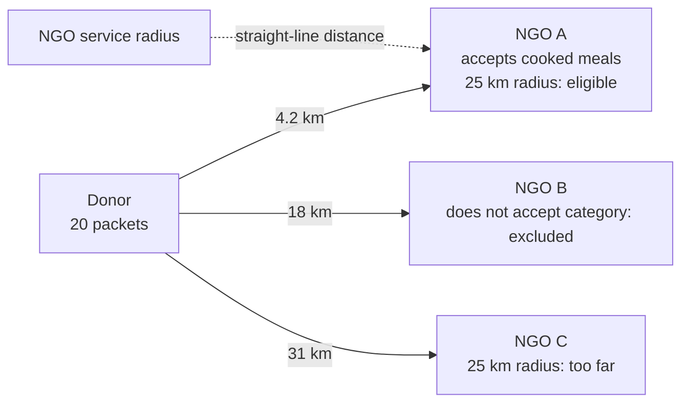
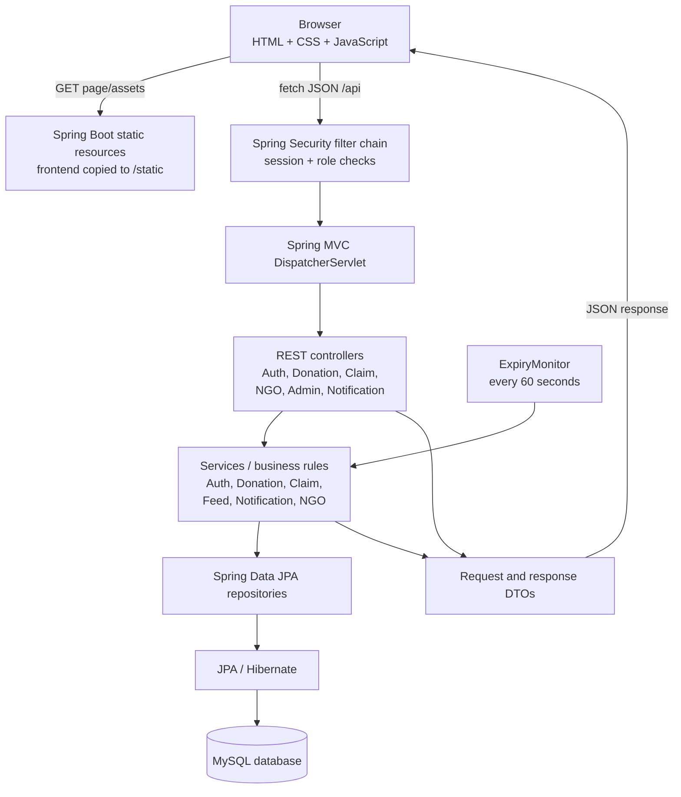
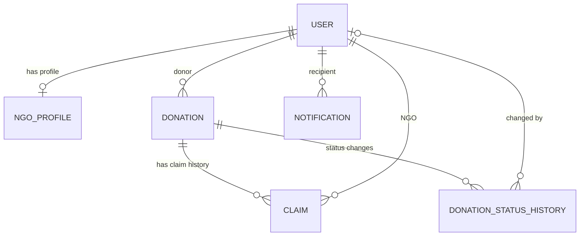
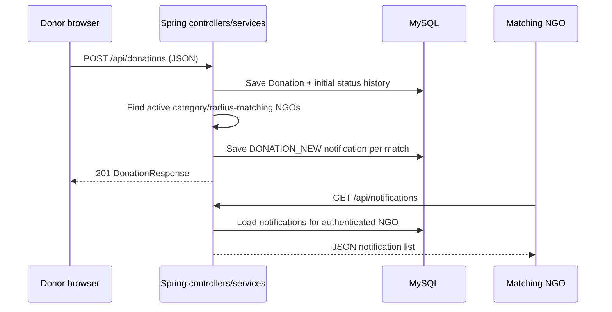

# RescuePlate: Project Explanation and Advanced Java Viva Guide

> **Source-grounded note:** This guide describes the checked-in implementation, not every feature suggested by older design notes or dashboard labels. Features marked **not implemented** are not part of the working application. Source links are relative to this document.

## 1. Project introduction

### What is RescuePlate?

RescuePlate is a web application that connects people or organizations with surplus food to nearby NGOs that can collect and distribute it. A donor posts the food type, quantity, pickup address, coordinates, and the time until which the food is safe. An NGO sees donations that match its accepted categories and service radius, claims one, and records pickup and delivery.

The practical problem is that surplus food is perishable: a useful donation can become unsafe or unusable if the people who can distribute it do not learn about it quickly. RescuePlate provides a shared, time-sensitive listing and a record of what happened to each donation. It does not itself transport or inspect food.

### Users and objectives

| User | Main purpose |
|---|---|
| **Donor** | Register, post surplus food, review personal donations, and receive claim and delivery updates. |
| **NGO** | Configure its location, accepted categories, service radius and nominal capacity; find and claim eligible donations; record pickup and delivery. |
| **Administrator** | Create/manage accounts and monitor users, donations, claims, and platform totals. |

The main objectives are to make listings discoverable to eligible nearby NGOs, prioritize urgent food, prevent multiple active claims for the same donation, record status changes, and keep both sides informed.

### System flow in plain language

1. A donor or NGO registers. The server stores the user and, for an NGO, an NGO profile.
2. The user signs in. Spring Security stores the authenticated identity in a server-side session.
3. A donor submits a donation. The backend validates it, saves it, records its initial status history, and creates notifications for active, nearby NGOs that accept its category.
4. An NGO configures coordinates, accepted categories, service radius, and capacity. The feed filters active donations by expiry, category, and distance, then sorts and paginates them.
5. On claim, the backend rechecks eligibility and availability inside a transaction. The donation becomes `RESERVED`, a claim is saved, and the donor is notified.
6. The NGO marks the claim picked up and then delivered. Donation and claim statuses are updated and notifications are stored.
7. A scheduled job marks overdue available, dispatching, or reserved donations expired.

### One-minute presentation introduction

> “Our project is RescuePlate, a web application for connecting surplus-food donors with nearby NGOs. Donors can post food details, quantity, pickup location, and a safe-until time. NGOs configure their location, service radius, and accepted food categories, then view nearby eligible donations ordered by urgency. An NGO can claim a donation, mark it picked up, and mark it delivered. The backend is built with Java 17 and Spring Boot, uses Spring MVC REST APIs, Spring Data JPA and Hibernate, and stores production data in MySQL. Spring Security provides role-based, session-based login. We also use geographic coordinates to calculate straight-line distance, a scheduled expiry check, status-history records, and database-backed notifications. The goal is to make time-sensitive surplus food easier for local NGOs to discover and coordinate.”

## 2. Technology stack: what and why

| Technology | Where it is actually used | Why it is useful here |
|---|---|---|
| **Java 17** | `pom.xml` sets `java.version` to 17; backend source is under `src/main/java/com/foodrescue/`. | Provides the language, type system, collections, date/time API, and runtime for the backend. |
| **Spring Boot 3.5.16** | Parent version in `pom.xml`; entry point is [`FoodRescueApplication`](../src/main/java/com/foodrescue/FoodRescueApplication.java). | Auto-configures the web server and Spring components so the application can be started as one backend. |
| **Spring MVC / Spring Web** | Controllers use `@RestController`, `@RequestMapping`, `@GetMapping`, `@PostMapping`, `@PutMapping`, and `@PatchMapping`. | Maps HTTP requests to Java methods and serializes responses. |
| **Embedded Tomcat** | Supplied by `spring-boot-starter-web`; Spring Boot serves both the API and static frontend. | Avoids needing a separately deployed servlet container for local use. |
| **Spring Data JPA** | Repository interfaces in `repository/` extend Spring Data repository abstractions. | Provides repository CRUD/query methods without handwritten SQL for ordinary operations. |
| **JPA and Hibernate ORM** | `jakarta.persistence` entity annotations and Hibernate schema configuration. | Maps Java entities and relationships to relational tables; Hibernate is the JPA provider. |
| **MySQL 8** | Runtime MySQL Connector/J dependency and default `jdbc:mysql://localhost:3306/food_rescue` URL in `application.properties`. | Intended persistent database for normal application runs. |
| **H2** | Test-scoped dependency and `application-workflow-test.properties`. | Provides an in-memory database for the workflow integration test; it is not the configured production database. |
| **Spring Security** | [`SecurityConfig`](../src/main/java/com/foodrescue/config/SecurityConfig.java), `CustomUserDetailsService`, and `AuthService`. | Authenticates users, stores session security context, hashes passwords, and restricts routes by role. |
| **Jakarta Bean Validation** | Request DTO constraints and `@Valid` controller parameters. | Rejects malformed or out-of-range request data before business logic accepts it. |
| **Jackson / JSON** | Spring Web request and response serialization; API timestamps are configured as ISO strings. | Lets browser JavaScript exchange structured data with Java endpoints. |
| **HTML** | Static role pages such as `frontend/donor-dashboard.html` and `frontend/ngo-dashboard.html`. | Defines forms, navigation, tables, dialogs, and dashboard structure. |
| **CSS** | `frontend/css/style.css` and role-specific styling. | Provides the RescuePlate visual design and responsive layouts. |
| **Vanilla JavaScript** | `frontend/js/donor-dashboard.js`, `ngo-dashboard-api.js`, `admin-dashboard.js`, `app.js`, and inline form scripts. | Calls APIs with `fetch`, validates user input, and renders responses without a frontend framework. |
| **Bootstrap 5.3.3** | CSS and, on dashboard pages, the Bootstrap bundle are loaded from a CDN. | Supplies responsive layout utilities and interactive components such as offcanvas navigation and modals. |
| **Bootstrap Icons 1.11.3** | Icon stylesheet is loaded from a CDN in the HTML pages. | Supplies the icons used in navigation, cards, and status messages. |
| **Maven** | `pom.xml` and Maven Wrapper scripts. | Resolves Java dependencies, compiles/tests the backend, packages it, and copies `frontend/` into Spring Boot's static resources. |
| **Git / GitHub** | This source is in the `RashmiRJ7/RescuePlate` repository. | Tracks and hosts the project source. Git/GitHub are development/version-control tools, not runtime dependencies. |
| **JUnit 5, Mockito, Spring test support** | Test dependencies and test classes under `src/test/java/`. | Test algorithms, services, controllers, security, and a full workflow. |
| **Browser Geolocation API** | Donor donation form and NGO profile UI call `navigator.geolocation.getCurrentPosition`. | Offers a convenient way to fill coordinates; users can also enter coordinates manually. |

The browser pages are served by Spring Boot: Maven copies `frontend/` to the classpath `static/` folder. There is no separate npm/Vite/React frontend project in the checked-in application. Bootstrap, its icons, Google Fonts, and some illustrative images are fetched from external CDNs/URLs, so those assets require network access.

### Technologies deliberately not claimed as active

- **Chart.js:** An `admin-analytics.js` file contains Chart.js calls, but `admin-dashboard.html` does not load that script or a Chart.js library; its analytics section is hidden and labels itself demo data. Chart.js is therefore not part of the active dashboard flow.
- **Postman:** No checked-in Postman collection or project configuration establishes that it is used.
- **IntelliJ IDEA / VS Code:** IDE choice is not a runtime technology and is not established by the application source. This workspace is being edited in VS Code, but no IDE-specific feature is required to run the application.
- **Direct JDBC, a JavaScript framework, and custom servlet classes:** These are not used directly; see Sections 3 and 12.

## 3. Advanced Java concepts used in RescuePlate

### Concept reference table

| Java concept | Used? | Actual source snippet / location | Explanation / viva phrasing |
|---|---:|---|---|
| Classes and objects | Yes | `new Donation(donor, request.foodName(), ...)` in `DonationService` | A class defines fields and behavior; an object is one runtime instance, such as a specific donation. |
| Encapsulation | Yes | `private Long id;` and `claim.markDelivered(now);` | State is held inside an object and accessed through methods. The state-transition service centralizes important donation changes. |
| Abstraction | Yes, mainly through framework contracts | `interface ClaimRepository extends JpaRepository<Claim, Long>` | Code depends on repository/security abstractions instead of implementing SQL or password algorithms itself. RescuePlate does not define a large custom abstract-class hierarchy. |
| Inheritance | Limited / indirect | `class ResourceNotFoundException extends RuntimeException` | Inheritance reuses/extends an existing type. It is not the main application design pattern. |
| Polymorphism | Yes, through interfaces/framework contracts | `class CustomUserDetailsService implements UserDetailsService` | Spring can call the implementation through the interface contract. There is no elaborate user-subclass hierarchy. |
| Interfaces | Yes | `Optional<User> findByEmail(String email);` in `UserRepository` | Interfaces state required operations while allowing the framework to provide or call an implementation. |
| Constructors | Yes | `this.notificationService = notificationService;` in the `DonationService` constructor | Constructors initialize objects. Dependency constructors receive the collaborators a service needs. |
| Access modifiers | Yes | `private final NotificationService notificationService;` | `private` hides internal details; `public` exposes the intended API to other classes. |
| Method overloading | Yes | `getFeed(..., Integer page, Integer size)` / `getFeed(..., Integer page, Integer size, Instant now)` | Same method name with different parameter lists. Explicit time overloads make logic deterministic in tests. |
| Method overriding | Yes | `@Override public UserDetails loadUserByUsername(String email)` | An implementation supplies behavior required by an interface or parent type. |
| `static` and `final` | Yes | `public static final double EARTH_RADIUS_KM = 6371.0;` | Static utility functions/constants do not need an object instance; `final` prevents reassignment or subclassing as applicable. |
| Enums | Yes | `public enum DonationStatus { AVAILABLE, DISPATCHING, RESERVED, ... }` | Restrict values to named states/categories and make invalid strings less likely in Java logic. JPA stores these as strings. |
| Exception handling | Yes | `throw new InvalidStatusTransitionException(fromStr, newStatus.name());` | Domain failures are raised as exceptions and translated into consistent API responses by `GlobalExceptionHandler`. |
| Collections Framework | Yes | `Map<DonationStatus, Set<DonationStatus>> ALLOWED_TRANSITIONS = Map.of(...)` | Holds candidate donations, accepted categories, transition tables, and validation errors. |
| Generics | Yes | `Optional<Claim> findByActiveDonationId(Long donationId);` | Adds compile-time information about what a collection or repository contains. |
| Lambda expressions | Yes | `.filter(d -> d.getStatus() == DonationStatus.AVAILABLE)` | A compact way to pass behavior, for example a sort or filter rule. |
| Stream API | Yes | `claims.stream().map(ClaimResponse::from).toList();` | Transforms collections declaratively, for example mapping entities to response DTOs. |
| `Optional` | Yes | `findByEmail(email).orElseThrow(() -> new ResourceNotFoundException(...))` | Represents a value that may be absent and encourages explicit not-found handling. |
| Date and Time API | Yes | `Duration.between(now, safeUntil).toMinutes()` | Stores absolute UTC instants and calculates time remaining without legacy `Date` arithmetic. |
| JDBC directly | **No** | No source snippet; there are no `DriverManager`, `Connection`, `PreparedStatement`, or `JdbcTemplate` calls. | Hibernate/JPA uses the database driver underneath; we write repository/entity code rather than direct JDBC calls. |
| Servlets directly | **No custom servlet** | `AuthService.login(..., HttpServletRequest httpRequest, HttpServletResponse httpResponse)` | Spring's servlet infrastructure receives HTTP requests. We do not write a class extending `HttpServlet`. |
| Multithreading in application logic | No custom worker pool | `@Scheduled(fixedDelay = 60_000)` delegates expiry to Spring; `ClaimConcurrencyTest` uses test threads. | The application relies on database transactions/version checks for competing claims. It does not implement its own background thread pool. |
| REST APIs and HTTP | Yes | `@PostMapping("/{id}/claim")` | Resources/actions are exposed over HTTP with JSON request/response bodies. |
| Spring MVC | Yes | `@RestController` and `@RequestMapping("/api/donations")` | Dispatcher infrastructure routes requests to controller methods; the controller delegates business work. |
| Dependency Injection (DI) | Yes | `public DonationService(DonationRepository donationRepository, ...)` | Dependencies are supplied by Spring rather than manually created inside each service. |
| Inversion of Control (IoC) / Spring beans | Yes | `@Service public class DonationService` | Spring creates and wires application components and manages their lifecycle. |
| Spring annotations | Yes | `@Transactional`, `@Valid`, `@Scheduled`, `@PrePersist` | Metadata tells Spring, JPA, or validation infrastructure how to handle a class or method. |
| Spring Data JPA repositories | Yes | `interface DonationRepository extends JpaRepository<Donation, Long>` | Repository interfaces provide database operations and derived queries. |
| Hibernate ORM / JPA entities | Yes | `@Entity @Table(name = "donations")` on `Donation` | ORM maps objects and their relationships to tables and foreign keys. |
| DTOs | Yes | `DonationResponse.from(saved, now, null)` | Separate API input/output shapes from database entities and avoid serializing entity graphs directly. |
| Request/response handling | Yes | `@RequestBody CreateDonationRequest request` → `ResponseEntity<DonationResponse>` | Binds JSON to a typed request and returns an explicit HTTP status/body. |
| Bean validation | Yes | `@Valid @RequestBody CreateDonationRequest request` | Validates incoming fields before business logic accepts them. |
| Spring Security | Yes | `new BCryptPasswordEncoder()` and `.hasRole("NGO")` | Authenticates identities and applies role-based access rules. |
| Session authentication | Yes | `return new HttpSessionSecurityContextRepository();` | The server stores the security context in an HTTP session; the browser sends its session cookie on later requests. |
| Configuration management | Yes | `@Value("${app.admin.setup-key:}") String setupKey` | Keeps database, port, and initial-admin setup settings outside hard-coded application logic. |
| Logging | Yes | `log.error("Unhandled exception at " + request.getRequestURI(), ex);` | Records unexpected failures and scheduled expiry activity. |
| Layered architecture | Yes, with some direct repository use in admin code | `donationService.createDonation(request, principal.getName())` | Separates HTTP, business rules, persistence, and API representations. `AdminController` does directly use repositories for several administrative reads/actions, so the layering is not absolute. |

### Short code examples to explain

**Constructor injection and service responsibility**

```java
public DonationService(DonationRepository donationRepository,
                       DonationStatusHistoryRepository historyRepository,
                       ClaimRepository claimRepository,
                       UserRepository userRepository,
                       NotificationService notificationService) {
    this.donationRepository = donationRepository;
    this.historyRepository = historyRepository;
    this.claimRepository = claimRepository;
    this.userRepository = userRepository;
    this.notificationService = notificationService;
}
```

`DonationService` receives collaborators from Spring. It does not construct its own repositories, so the service is easier to test with mocks.

**DTO input and validation**

```java
public ResponseEntity<DonationResponse> createDonation(
        @Valid @RequestBody CreateDonationRequest request, Principal principal) {
    DonationResponse response = donationService.createDonation(request, principal.getName());
    return ResponseEntity.status(HttpStatus.CREATED).body(response);
}
```

Spring/Jackson binds JSON to a request DTO. `@Valid` applies its constraints. The controller identifies the current principal, delegates business logic, and returns a response DTO with HTTP 201.

**Enums and state transitions**

```java
private static final Map<DonationStatus, Set<DonationStatus>> ALLOWED_TRANSITIONS = Map.of(
    DonationStatus.AVAILABLE, Set.of(DonationStatus.DISPATCHING,
        DonationStatus.RESERVED, DonationStatus.EXPIRED, DonationStatus.CANCELLED)
);
```

The real transition table in `DonationService` includes rules for every status. Illegal transitions throw `InvalidStatusTransitionException`; callers cannot move a delivered donation back to available.

**Collections, streams, and lambdas**

```java
return paged.stream().map(s -> {
    Donation d = s.donation();
    return new DonationFeedResponse(d.getId(), d.getFoodName(), d.getCategory(),
        d.getQuantity(), d.getDonor().getName(), d.getPickupAddress(),
        dist, minutesLeft, d.getSafeUntil(), s.urgencyScore(), exceedsCapacity, d.getStatus());
}).toList();
```

The feed transforms scored donation objects into API DTOs. A stream is not automatically faster; here it makes the mapping step concise.

**Optional and exceptions**

```java
User user = userRepository.findByEmail(email)
    .orElseThrow(() -> new ResourceNotFoundException("User not found with email: " + email));
```

The repository may not find an email. `orElseThrow` converts that absence into a meaningful domain error that `GlobalExceptionHandler` maps to HTTP 404.

**Date/time**

```java
long minutesLeft = Math.max(0, Duration.between(now, safeUntil).toMinutes());
```

The application stores `Instant` values and compares them against a reference instant. The configured database JDBC timezone is UTC.

### MVC and persistence concepts in everyday terms

- **Controller:** front desk; understands HTTP and validates/binds the request.
- **Service:** business decision-maker; applies donation, claim, eligibility, and expiry rules.
- **Repository:** database access point; asks JPA/Hibernate to load or save entities.
- **Entity:** persistent record model.
- **DTO:** a deliberately shaped message sent to or received from the browser.
- **Spring bean:** an object Spring constructs and manages.
- **ORM:** object-relational mapping; Hibernate translates entity operations into database operations.
- **JPA vs. Hibernate:** JPA is the standard API/annotations; Hibernate is the provider implementing that API in this project.
- **JDBC vs. JPA:** JDBC exposes low-level SQL/connection operations. RescuePlate uses JPA repositories; Hibernate ultimately uses a JDBC driver to talk to MySQL.

### HTTP methods actually present

| Method | General meaning | RescuePlate usage |
|---|---|---|
| `GET` | Read without intentionally changing resource state | Lists feeds, profiles, donations, claims, notifications, admin data, and health. |
| `POST` | Create or perform an action | Registration, login, initial admin setup, donation creation, and claiming a donation. |
| `PUT` | Replace/update a resource representation | NGO profile settings at `PUT /api/ngo/profile`. |
| `PATCH` | Apply a partial/action-oriented state change | Cancel/pickup/deliver claims, mark notifications read, toggle a user. |
| `DELETE` | Delete a resource | **No DELETE API endpoint is implemented.** |

## 4. Why latitude and longitude?

Latitude and longitude are a pair of angular coordinates that identify a point on Earth:

- **Latitude** is north/south position relative to the equator, from `-90` to `90` degrees.
- **Longitude** is east/west position relative to the prime meridian, from `-180` to `180` degrees.

An address is useful to a person but is not a reliable numeric input for a distance formula. Addresses can be ambiguous, formatted differently, or contain the same street name in different areas. RescuePlate stores a pickup address for humans and coordinates for distance comparisons. It does **not** geocode an address into coordinates or calculate road routes.

### Where coordinates come from and what happens when missing

- Donors can type latitude/longitude into the donation form or use the browser's geolocation button in `donor-dashboard.js`.
- The donation request may omit both coordinates only when the donor already has both saved on the user record. `DonationService.createDonation` then uses that pair.
- Supplying only one coordinate is rejected. If neither a request pair nor a saved donor pair exists, the donation is rejected with latitude/longitude field errors. The `Donation` entity requires both values.
- NGOs can enter both coordinates manually or use browser geolocation in `ngo-dashboard-api.js`; `NgoProfileService.updateProfile` saves them on the NGO's `User`.
- An NGO with missing coordinates cannot get a nearby feed. Claim eligibility also rejects a claim if either side's coordinates are missing.
- The frontend requests browser permission; if permission is denied or unavailable, it asks the user to enter coordinates manually.

### Haversine formula used by the source

[`DistanceUtil.calculateDistanceKm`](../src/main/java/com/foodrescue/algorithm/DistanceUtil.java) computes great-circle, straight-line distance using a spherical Earth radius of `6371.0 km`.

For points `(latitude1, longitude1)` and `(latitude2, longitude2)`, convert degrees to radians and define:

```text
Δφ = φ2 - φ1
Δλ = λ2 - λ1
a  = sin²(Δφ / 2) + cos(φ1) cos(φ2) sin²(Δλ / 2)
c  = 2 asin(min(1, sqrt(a)))
d  = R × c
```

Here `φ` is latitude in radians, `λ` is longitude in radians, `R = 6371 km`, and `d` is distance in kilometres. The implementation rounds the result to one decimal place. Its `min(1, sqrt(a))` protects the inverse-sine calculation from floating-point overshoot.

**Service radius** is also measured in kilometres. An NGO configured for a `20 km` radius is eligible only when the calculated straight-line distance is at most 20 km. This is not a promise that the road journey is 20 km or takes a particular time.

### How the NGO feed uses location

`FeedService.getFeed`:

1. Loads the authenticated NGO and its profile.
2. Requires NGO coordinates.
3. Starts with a service radius; an optional `maxDistanceKm` filter can only narrow it (`min(profile radius, supplied maximum)`).
4. Considers only donations in `AVAILABLE` or `DISPATCHING` whose `safeUntil` is after the current time.
5. Excludes categories not accepted by the NGO, plus optional category and minimum-quantity filter failures.
6. Calculates Haversine distance and excludes donations outside the effective radius.
7. Scores, sorts, paginates, and maps the remaining records to `DonationFeedResponse`.

The claim endpoint repeats key eligibility checks; hiding a listing from the feed is not the only protection.

**Example:** A donor posts 20 packets at coordinates `(15.85, 74.50)`. Assume an NGO profile accepts cooked meals and has a 25 km radius. NGO A is 4.2 km away and accepts that category, so it can see and attempt to claim the donation. NGO B is 18.0 km away but accepts only packaged food, so it is excluded by category. NGO C is 31.0 km away, so it is excluded by radius. Capacity does not reject the claim; it is only reported as a capacity warning in the feed response.



### Important location caveats

- The calculation is **straight-line**, not driving distance.
- There is no map-routing provider or address-geocoding service in the backend.
- `DistanceUtil.estimateTravelMinutes` exists as a simple distance-times-minutes-per-kilometre helper, but the NGO eligibility/feed flow does not use it to predict real journey time.
- `ScoringProperties.Distance` has distance defaults, but `DistanceUtil` uses its own constants; do not claim that the configured distance properties currently change the Haversine calculation.

## 5. Complete system architecture

RescuePlate is a **layered monolith**: one Spring Boot application contains the API and serves static frontend files. It is not a collection of separately deployed microservices.



The main request path is controller → service → repository → Hibernate/JPA → database. There are small exceptions: `AdminController` directly uses repositories for platform lists, totals, and user toggling; `DonationController` uses `UserRepository` to resolve the current user for individual donation/history reads. The diagram shows the normal path, not a claim that every method has identical layering.

### What happens when the user clicks “Post donation”?

1. `donor-dashboard.js` reads form fields, validates them, converts the selected local date/time to an ISO instant, and calls `fetch("/api/donations", ...)` with JSON and `credentials: "include"`.
2. The browser sends the session cookie, if signed in.
3. Spring Security validates the session and requires the `DONOR` role for `POST /api/donations`.
4. Spring MVC binds the JSON body to `CreateDonationRequest`; `@Valid` runs request constraints.
5. `DonationController.createDonation` passes the DTO and authenticated principal's email to `DonationService.createDonation`.
6. The service validates coordinate pairing/fallback and time rules, creates the entity, saves it, records initial history, and asks `NotificationService` to notify matching NGOs.
7. Spring Data JPA and Hibernate persist the work within the transaction.
8. The controller returns HTTP 201 and a `DonationResponse`; Jackson serializes it as JSON.
9. JavaScript updates the donation list and summary cards in the page.

Separating layers makes it easier to test business rules without simulating HTTP, change persistence without rewriting page code, and avoid returning database entities directly to clients.

## 6. Database explanation

The six JPA entities map to the tables `users`, `ngo_profiles`, `donations`, `claims`, `donation_status_history`, and `notifications`. Primary keys use `Long` with `GenerationType.IDENTITY`; table/column details are declared by JPA annotations in `entity/`.

| Entity/table | Purpose and important columns |
|---|---|
| [`User`](../src/main/java/com/foodrescue/entity/User.java) / `users` | Account identity: `id`, `name`, unique `email`, `password_hash`, string `role`, optional phone/address/latitude/longitude, `active`, and `created_at`. Passwords are stored as BCrypt hashes, not plaintext. |
| [`NgoProfile`](../src/main/java/com/foodrescue/entity/NgoProfile.java) / `ngo_profiles` | NGO-specific settings: unique `user_id`, `capacity_meals`, `service_radius_km`, accepted category names, and total/completed-claim counters. Accepted categories are stored as a comma-separated string and converted to/from a Java `Set<FoodCategory>`. |
| [`Donation`](../src/main/java/com/foodrescue/entity/Donation.java) / `donations` | Food listing: donor FK, food name/category/quantity/description, pickup address, required coordinates, `ready_from`, `safe_until`, status, dispatch-round fields, optimistic-lock `version`, and created/updated timestamps. It has a status/safe-until index. |
| [`Claim`](../src/main/java/com/foodrescue/entity/Claim.java) / `claims` | NGO claim for a donation: donation FK, NGO user FK, status, nullable unique `active_donation_id`, claimed/pickup/delivery/cancellation timestamps, and cancellation reason. The NGO/status pair is indexed. |
| [`DonationStatusHistory`](../src/main/java/com/foodrescue/entity/DonationStatusHistory.java) / `donation_status_history` | Audit record for each status change: donation FK, nullable `from_status` for the initial event, required `to_status`, optional actor user FK, note, and timestamp. |
| [`Notification`](../src/main/java/com/foodrescue/entity/Notification.java) / `notifications` | Recipient FK, type, title, message, scalar `donation_id`, read flag, created/read timestamps. Recipient/read and created-at indexes support list/count queries. `donation_id` is not mapped as a JPA relationship. |

### Actual relationships



- `NgoProfile.user` is the owning one-to-one relationship; `NgoProfile.user_id` is unique. `User.ngoProfile` is the inverse side (`mappedBy = "user"`).
- A donor `User` can have many `Donation` records (`Donation.donor` is `ManyToOne`).
- A `Donation` can have multiple historical `Claim` rows over its lifecycle. Only one claim can hold its non-null `active_donation_id` at a time; cancelling/expiring a claim nulls this unique value.
- A `Claim` refers to its NGO through a `ManyToOne` `User` relationship.
- A donation has many status-history rows. An automated history entry may have no actor.
- A user may receive many notifications. Notification `donationId` is only a scalar reference, not a foreign-key relationship declared by this entity.

### How persistence is configured

- Runtime defaults are in `src/main/resources/application.properties`: MySQL at `localhost:3306/food_rescue`, port `8080`, and `spring.jpa.hibernate.ddl-auto=update`.
- `spring.config.import=optional:file:.env[.properties]` lets local environment settings load; environment variables can override them. The file is optional. Do not commit credentials or admin setup secrets.
- Hibernate derives/updates tables from entity mappings. There is no Flyway/Liquibase migration setup in the dependency/source inventory, so `ddl-auto=update` is the schema-update mechanism in this configuration.
- `spring.jpa.open-in-view=false` disables Open EntityManager in View; API methods map entities to DTOs in service/transaction scopes instead of depending on a session remaining open through response rendering.
- Timestamps use `Instant`; Hibernate JDBC time zone and Jackson time zone are set to UTC, and Jackson writes ISO-formatted date strings.
- Tests use H2 with `create-drop` in `application-workflow-test.properties`; the ordinary runtime uses MySQL configuration.

## 7. Complete application workflow

### Donor workflow

1. **Register:** `POST /api/auth/register` accepts `RegisterRequest` with `DONOR` or `NGO`; `AuthService.register` explicitly rejects `ADMIN`. The browser form collects name, email, phone, address, role, and password. It does not collect coordinates.
2. **Login:** the browser posts email/password; after successful login the browser checks the selected role against the server response and navigates to the matching dashboard.
3. **Create donation:** donor submits food name, category, quantity, description, ready-from time, safe-until time, address, and optional coordinate pair. If coordinates are omitted, the service tries the saved donor pair.
4. **Save and record:** `DonationService` stores the donation with status `AVAILABLE`, creates an initial history row, and sends `DONATION_NEW` notifications to matching active NGOs.
5. **View own data:** `GET /api/donations/mine` is scoped to the logged-in donor and can be filtered by status. The donor dashboard fetches the real backend list for its cards/table.
6. **Updates:** claim, cancellation, pickup, and delivery events create the notification types described below. The donor page polls for updates; it is not a WebSocket push system.

### NGO workflow

1. Register with the `NGO` role and sign in.
2. Set coordinates, accepted categories, nominal meal capacity, and service radius through `GET/PUT /api/ngo/profile`. The initial profile created by `AuthService` defaults to capacity 50, radius 10 km, and all categories when no profile settings are supplied.
3. Load `/api/donations/feed`; the NGO UI can filter category, search loaded listings, and choose a maximum distance. Backend query parameters also support minimum quantity and pagination.
4. Claim a listing with `POST /api/donations/{id}/claim`. Eligibility and availability are checked again server-side.
5. Use `PATCH /api/claims/{id}/pickup`, then `PATCH /api/claims/{id}/deliver`. The latter changes the claim to `COMPLETED` and donation to `DELIVERED`.
6. Cancel an active claim with `PATCH /api/claims/{id}/cancel`. The claim becomes `CANCELLED`, its active unique key is released, and the donation reopens as `AVAILABLE`.

### Administrator workflow

1. The initial administrator is created through `/admin-setup.html` and `POST /api/auth/admin-setup`, only when an `ADMIN_SETUP_KEY` is configured and no admin exists. The key is compared on the server.
2. Admin signs in using the same session login mechanism.
3. Active admin APIs provide totals, lists of users/donations/claims, creation of further admins, and toggling a non-admin user's active state.
4. **Complaints and reports are not implemented as backend APIs.** The active admin dashboard displays live users, donations, claims and totals. Its hidden analytics region is explicitly demo data; the active HTML does not load its separate analytics script or Chart.js.

### Notifications: creation, storage, retrieval, and display

`NotificationService` creates `Notification` entities and persists them through `NotificationRepository`. The event methods and recipients are:

| Event | Type | Recipient(s) |
|---|---|---|
| New donation posted | `DONATION_NEW` | Active NGOs with coordinates, a matching accepted category, and the donation inside their configured radius. |
| Donation claimed | `CLAIM_CREATED` | Donation's donor. |
| Claim cancelled | `CLAIM_CANCELLED` | Donor and the NGO that cancelled its claim. |
| Food picked up | `CLAIM_PICKED_UP` | Donor. |
| Food delivered | `CLAIM_DELIVERED` | Donor and claiming NGO. |

The authenticated recipient retrieves their own notifications through `GET /api/notifications?page=0&size=20`; page size is capped at 100 in `NotificationService`. The frontend displays title, message, and formatted time. `PATCH /api/notifications/{id}/read` and `/read-all` mark them read; unread count is queried separately. Notification ownership is enforced by looking up an ID together with the recipient's user ID.

The donor and NGO dashboard scripts poll selected live data approximately every 30 seconds. There is no email, SMS, push, or WebSocket delivery. `EXPIRY_WARNING` exists in the notification enum/UI mapping, but no expiry-warning notification emission was found. Expiry itself is recorded as a status-history event.

**Notification sequence**



## 8. REST API reference

All API paths are under `/api`. Bodies and responses use JSON unless marked as empty. The browser uses same-origin `fetch` calls and sends session credentials. **Role protections below come from `SecurityConfig`; resource ownership checks are also enforced in services where noted.**

### Health and authentication

| Method and URL | Purpose / access | Input and response | Handler |
|---|---|---|---|
| `GET /api/health` | Public liveness response. | No body; `{"status":"UP","timestamp":"..."}`. | `HealthController.health()` |
| `GET /api/auth/admin-setup/status` | Public availability check for first-admin setup. | No body; `AdminSetupStatusResponse`. | `AuthController.adminSetupStatus()` → `AdminAccountService.isInitialSetupAvailable()` |
| `POST /api/auth/admin-setup` | Public one-time first-admin creation, guarded by server setup key and no-existing-admin check. | `InitialAdminSetupRequest` (name/email/password/confirmation/setup key/phone); 201 `AuthUserResponse`. | `AuthController.createInitialAdmin()` → `AdminAccountService.createInitialAdmin()` |
| `POST /api/auth/register` | Public donor/NGO registration; `ADMIN` registration is rejected. | `RegisterRequest`; 201 `AuthUserResponse`. | `AuthController.register()` → `AuthService.register()` |
| `POST /api/auth/login` | Public login; creates/saves session context on success. | `{"email":"...","password":"..."}`; 200 `LoginResponse`, with session cookie set by servlet infrastructure. | `AuthController.login()` → `AuthService.login()` |
| `POST /api/auth/logout` | Clears current session security context. | No required body; JSON empty map response. | `AuthController.logout()` → `AuthService.logout()` |
| `GET /api/auth/me` | Authenticated current-user profile. | No body; `UserProfileResponse`. | `AuthController.getMe()` → `AuthService.getMe()` |

### Donations and claims

| Method and URL | Purpose / access | Input and response | Handler |
|---|---|---|---|
| `POST /api/donations` | Create a donation; `DONOR` only. | `CreateDonationRequest`; 201 `DonationResponse`. | `DonationController.createDonation()` → `DonationService.createDonation()` |
| `GET /api/donations/mine?status=AVAILABLE` | List current donor's own donations; `DONOR` only; `status` optional. | No body; list of `DonationResponse`. | `DonationController.getMyDonations()` → `DonationService.getMyDonations()` |
| `GET /api/donations/feed?category=COOKED_MEAL&minQuantity=10&maxDistanceKm=20&page=0&size=20` | NGO feed; `NGO` only. Every query parameter is optional. | No body; list of `DonationFeedResponse`. | `DonationController.getFeed()` → `FeedService.getFeed()` |
| `GET /api/donations/{id}` | Read one authenticated user's donation. Donors are restricted to their own; service does not apply the same ownership restriction to non-donor roles. | No body; `DonationResponse`. | `DonationController.getDonationById()` → `DonationService.getDonationById()` |
| `GET /api/donations/{id}/history` | Read a donation's status history. Donors are restricted to their own donations. | No body; list of `DonationHistoryResponse`. | `DonationController.getDonationHistory()` → `DonationService.getDonationHistory()` |
| `POST /api/donations/{id}/claim` | NGO claims an eligible donation; `NGO` only. | Empty JSON object is used by the UI; 201 `ClaimResponse`. | `DonationController.claimDonation()` → `ClaimService.claim()` |
| `GET /api/claims/mine?status=ACTIVE` | Current NGO's claims; `NGO` only; optional status. | No body; list of `ClaimResponse`. | `ClaimController.getMyClaims()` → `ClaimService.getMyClaims()` |
| `PATCH /api/claims/{id}/cancel` | Cancel an active claim; `NGO` only and must be its owner. | Optional `{"reason":"..."}`; 200 `ClaimResponse`. | `ClaimController.cancelClaim()` → `ClaimService.cancelClaim()` |
| `PATCH /api/claims/{id}/pickup` | Mark an active claim picked up; `NGO` only and must be its owner. | No required body; 200 `ClaimResponse`. | `ClaimController.pickupClaim()` → `ClaimService.pickupClaim()` |
| `PATCH /api/claims/{id}/deliver` | Mark a picked-up claim delivered; `NGO` only and must be its owner. | No required body; 200 `ClaimResponse`. | `ClaimController.deliverClaim()` → `ClaimService.deliverClaim()` |

Example donation body (coordinates must be supplied together, or omitted together when the donor has saved coordinates):

```json
{
  "foodName": "Rice and dal",
  "category": "COOKED_MEAL",
  "quantity": 20,
  "description": "Packed meal portions",
  "readyFrom": "2026-03-20T08:00:00Z",
  "safeUntil": "2026-03-20T12:00:00Z",
  "pickupAddress": "Example area, city",
  "latitude": 15.85,
  "longitude": 74.50
}
```

### NGO profile, notifications, and administration

| Method and URL | Purpose / access | Input and response | Handler |
|---|---|---|---|
| `GET /api/ngo/profile` | Read current NGO profile; `NGO` only. | No body; `NgoProfileResponse`. | `NgoProfileController.getProfile()` → `NgoProfileService.getProfile()` |
| `PUT /api/ngo/profile` | Update capacity, radius, accepted categories, and optional coordinate pair; `NGO` only. | `NgoProfileUpdateRequest`; `NgoProfileResponse`. | `NgoProfileController.updateProfile()` → `NgoProfileService.updateProfile()` |
| `GET /api/notifications?page=0&size=20` | Current user's notifications; any authenticated role. | No body; list of `NotificationResponse`. | `NotificationController.listNotifications()` → `NotificationService.getNotifications()` |
| `GET /api/notifications/unread-count` | Current user's unread count; any authenticated role. | No body; JSON number. | `NotificationController.unreadCount()` → `NotificationService.getUnreadCount()` |
| `PATCH /api/notifications/{id}/read` | Mark one owned notification read; any authenticated role. | No body; 204. | `NotificationController.markRead()` → `NotificationService.markRead()` |
| `PATCH /api/notifications/read-all` | Mark current user's unread notifications read; any authenticated role. | No body; 204. | `NotificationController.markAllRead()` → `NotificationService.markAllRead()` |
| `GET /api/admin/stats` | Platform totals and selected donation status counts; `ADMIN` only. | No body; `AdminStatsResponse`. | `AdminController.getStats()` |
| `GET /api/admin/users` | List users; `ADMIN` only. | No body; list of `AdminUserResponse`. | `AdminController.getUsers()` |
| `GET /api/admin/donations` | List donations; `ADMIN` only. | No body; list of `AdminDonationResponse`. | `AdminController.getDonations()` |
| `GET /api/admin/claims` | List claims; `ADMIN` only. | No body; list of `AdminClaimResponse`. | `AdminController.getClaims()` |
| `POST /api/admin/users/admins` | Create another admin; `ADMIN` only. | `AdminAccountRequest`; 201 `AuthUserResponse`. | `AdminController.createAdmin()` → `AdminAccountService.createAdmin()` |
| `PATCH /api/admin/users/{id}/toggle` | Toggle an active donor/NGO account; `ADMIN` only. Admin accounts cannot be deactivated by this method. | No body; updated `AdminUserResponse`. | `AdminController.toggleUser()` |

There is **no** implemented `DELETE` endpoint, complaints endpoint, reports endpoint, or donation cancellation controller method. `SecurityConfig` contains a matcher for `PATCH /api/donations/*/cancel`, but no matching handler exists in `DonationController`; do not present donor/admin donation cancellation as a working API.

## 9. Authentication and security

### Registration and password storage

`AuthService.register` rejects the `ADMIN` role, checks duplicate email, validates that coordinates are supplied as a pair, BCrypt-encodes the password using Spring's `PasswordEncoder`, and saves a `User`. For an NGO it also creates an `NgoProfile`. The browser never receives the stored password hash.

### Login, sessions, and JSESSIONID

1. The browser posts email and password to `/api/auth/login`.
2. `AuthenticationManager` authenticates using the `UserDetailsService` implementation `CustomUserDetailsService`, which loads by email and provides a `ROLE_...` authority and the BCrypt hash.
3. `AuthService.login` creates a `SecurityContext` and saves it via `HttpSessionSecurityContextRepository`.
4. The servlet container maintains the HTTP session and sends a session identifier cookie, commonly named `JSESSIONID`.
5. The frontend's `fetch` uses `credentials: "include"` so later same-origin API calls include the session cookie. Spring Security then resolves the principal for controller/service calls.

A session is server-maintained state spanning multiple HTTP requests. `JSESSIONID` is a browser-held identifier for that session; it is not the user's password and should be treated as sensitive.

### Roles and access control

`SecurityConfig` uses `hasRole("DONOR")`, `hasRole("NGO")`, and `hasRole("ADMIN")` for the main API groups. The frontend redirects to the dashboard based on `GET /api/auth/me`, but UI routing is not the security boundary: the backend filters enforce access. `ClaimService` additionally verifies that an NGO owns the claim it is changing; `NotificationService` scopes read operations by recipient ID; donation service methods restrict donor reads to the donor's own records.

Passwords use BCrypt via `BCryptPasswordEncoder`. Inactive users are marked disabled by `CustomUserDetailsService`; Spring Security rejects login for them. Authentication failures are returned as 401 JSON, and access-denied failures as 403 JSON.

### First administrator setup

The key is configured server-side through `ADMIN_SETUP_KEY` (bound as `app.admin.setup-key`). It is not embedded as a constant in the frontend JavaScript. During first setup, the browser submits it to the public initial-setup endpoint; `AdminAccountService.createInitialAdmin` compares byte arrays with `MessageDigest.isEqual`, checks that an admin does not already exist, verifies password confirmation, hashes the password, and saves the account. A static synchronized lock and transaction protect this operation within one application process. Do not claim that this JVM lock alone coordinates multiple application replicas.

### Honest security caveats

- `SecurityConfig` currently disables CSRF protection. Because authentication is cookie/session based, production deployment should review CSRF defenses and cookie settings rather than assuming this setting is production hardened.
- The login page has a “remember me” checkbox, but its submit code sends only email and password; it does not activate persistent remember-me authentication.
- The “Forgot password?” link displays that password recovery is unavailable.
- Keep database credentials and the initial-admin key in environment configuration / an ignored local `.env`, not in frontend files or committed source. Use HTTPS in deployment so credentials and session cookies are protected in transit.
- The selected login role is checked in browser JavaScript after the backend authenticates and returns the actual role; the role radio value is not part of the login JSON request.

## 10. Important algorithms and business logic

### A. Distance and eligibility

See Section 4 for the full Haversine formula. `FeedService.getFeed` filters by:

1. Donation status `AVAILABLE` or `DISPATCHING`.
2. `safeUntil` later than the current instant.
3. NGO accepted category and optional requested category.
4. Optional minimum quantity.
5. Haversine distance within `min(NGO service radius, requested max distance)`.

An NGO with a 10 km radius does not receive a donation 12 km away, even if it matches the food category. A request maximum of 5 km further narrows a 10 km profile to 5 km. A request maximum larger than the profile does not expand it.

`ClaimService.claim` independently checks active NGO status, profile, accepted category, coordinates, radius, donation status, expiry, and presence of an active claim. `capacityMeals` only produces `exceedsCapacity` in the feed response; it does not prevent claiming.

### B. Urgency score and sorting

`UrgencyScoreCalculator` produces a 0–100 score, rounded to one decimal place:

```text
urgency = 0.60 × timeScore
        + 0.30 × perishabilityScore
        + 0.10 × quantityScore
```

Default values are in `ScoringProperties.Urgency`:

- Time score is 100 when at most 30 minutes remain, 0 at or beyond 360 minutes, and linear between those points.
- Perishability: cooked meal = 100; bakery/fresh produce = 60; packaged = 20.
- Quantity score is clamped from 0 to 100.
- Expired or missing-deadline donation scores 0.

`DonationFeedComparator` sorts by highest rounded urgency, then earlier `safeUntil`, then higher quantity, then lower ID for deterministic ordering. The feed is **not** sorted by nearest distance, and no separate NGO reliability or match score is used to order it.

Example: a cooked meal expiring in 20 minutes receives time score 100, perishability 100, and if quantity is 20 then quantity score 20. Its score is `0.60×100 + 0.30×100 + 0.10×20 = 92`.

### C. Expiry and safe-until

`DonationService.createDonation` defaults `readyFrom` to now if omitted and rejects a `safeUntil` before `readyFrom` or less than 30 minutes in the future. Request DTO validation also enforces required/range constraints.

`SchedulingConfig` enables scheduled tasks. `ExpiryMonitor.monitorExpiry` runs with a 60-second fixed delay and delegates to `DonationService.expireOverdueDonations`. That service searches `AVAILABLE`, `DISPATCHING`, and `RESERVED` donations with `safeUntil` before the current instant, moves each to `EXPIRED`, records history, and marks any active claim expired. A picked-up donation is not automatically expired by this job.

`readyFrom` is stored and validated as a request field, but the current feed/claim filters do not wait until `readyFrom` before exposing/allowing a claim. Do not claim that the implementation enforces a scheduled release time.

### D. Donation and claim state lifecycles

Donation state changes are centralized in `DonationService.changeStatus`; each accepted change saves a `DonationStatusHistory` row. The legal transitions are:

```text
AVAILABLE   -> DISPATCHING, RESERVED, EXPIRED, CANCELLED
DISPATCHING -> AVAILABLE, RESERVED, EXPIRED, CANCELLED
RESERVED    -> AVAILABLE, DISPATCHING, PICKED_UP, EXPIRED, CANCELLED
PICKED_UP   -> DELIVERED, CANCELLED
DELIVERED, EXPIRED, CANCELLED -> no further transition
```

Claim status is separate:

```text
ACTIVE -> PICKED_UP -> COMPLETED
   |                     (terminal)
   +-> CANCELLED
ACTIVE may become EXPIRED when its underlying reserved donation expires
```

The successful terminal pair is **donation `DELIVERED`** and **claim `COMPLETED`**. A claim cancellation is only allowed while `ACTIVE`; it reopens the donation as `AVAILABLE`. No automatic dispatch scheduler was found even though `DISPATCHING`, `dispatchRound`, and `roundEndsAt` exist in the model/state machine.

### E. Preventing duplicate claims

There are multiple safeguards:

1. Claim service rejects non-claimable donation states, expired donations, and an existing active claim.
2. `Donation` has a JPA `@Version` field for optimistic locking.
3. `Claim.active_donation_id` is nullable and unique. Active claims keep the donation ID; cancellation/expiry clears it, permitting a later claim.
4. Claim and donation writes are performed in a transaction and explicitly flushed so database conflicts occur within that transaction.
5. Optimistic-lock and database-integrity conflicts are mapped to HTTP 409.

This is not a guarantee from a frontend button disable; it is enforced in backend/database behavior. `ClaimConcurrencyTest` exercises competing controller requests using test threads/mocks. It is not itself a real concurrent MySQL integration test.

### F. Validation and pagination

- Request records use Jakarta Validation constraints; controller methods use `@Valid`.
- Donation service adds cross-field checks: coordinate pairs, saved donor location fallback, and `safeUntil` relationships.
- Feed pagination defaults to page `0`, size `20` when absent/invalid; it is applied after eligibility filtering and sorting.
- Notification pagination defaults to page `0`, size `20`, and clamps size to at most `100`.
- Donation/claim/admin list endpoints do not all use pagination; do not generalize feed pagination to the whole API.
- Quantity categories are enums, so unrecognized categories fail request deserialization/validation rather than silently becoming another category.

## 11. Advanced Java practical viva questions and answers

### Core and framework questions

1. **Why did you choose Java?**  
   Java gives us a strongly typed backend language and an established ecosystem for HTTP services, database persistence, validation, and security. RescuePlate targets Java 17 in Maven.

2. **Why Spring Boot?**  
   It configures the web application and embedded server with less manual setup. We use it to serve the frontend and REST API from one application.

3. **What is Spring MVC?**  
   It is Spring's request-routing and web layer. For example, `@GetMapping("/mine")` in `DonationController` routes an HTTP GET to a Java method.

4. **What is dependency injection?**  
   It means a class receives the objects it depends on. `DonationService` receives repositories and `NotificationService` through its constructor instead of calling `new` for them.

5. **What is inversion of control?**  
   Spring, rather than application code, creates and manages beans and calls the right components at runtime. DI is one way that IoC appears in this application.

6. **What is a Spring bean?**  
   An object managed by Spring's application context. `@Service` classes and `@RestController` classes are examples.

7. **What is an annotation?**  
   Metadata that frameworks inspect. `@Entity` marks a persistent class, `@Transactional` sets transaction behavior, and `@Scheduled` marks a scheduled method.

8. **Why use constructor injection?**  
   It makes required dependencies explicit and allows tests to supply mocks. It also avoids hidden field-level dependencies.

9. **Why use interfaces?**  
   `UserDetailsService` is a Spring Security contract implemented by `CustomUserDetailsService`; Spring Data repository interfaces describe persistence operations. We do not have a separate interface for every application service.

10. **What is method overriding in RescuePlate?**  
    `CustomUserDetailsService.loadUserByUsername` implements/overrides the method required by `UserDetailsService`.

11. **Where is method overloading used?**  
    For example, `FeedService.getFeed` has a normal version and a version accepting an explicit `Instant now`. The explicit-time overload makes score/expiry tests deterministic.

12. **What is an enum, and why use it?**  
    It is a fixed set of named values. `DonationStatus` prevents arbitrary strings from becoming states such as `"almost_done"`.

13. **What is encapsulation?**  
    Keeping object state and operations together while controlling access. `Claim.markDelivered` updates claim status and timestamp together.

14. **What is inheritance?**  
    One type extends another. RescuePlate uses it narrowly, such as custom exception types extending exception classes; composition and framework contracts are more prominent than a deep inheritance tree.

15. **What is polymorphism here?**  
    Spring can call `CustomUserDetailsService` through the `UserDetailsService` interface. The concrete implementation supplies the behavior.

16. **What is a generic type?**  
    A type parameter that preserves compile-time element types, such as `List<Donation>` or `JpaRepository<Donation, Long>`.

17. **Why use collections?**  
    The feed holds candidate donations in a `List`, accepted categories in a `Set`, and legal transitions in a `Map`. These match the operations needed by the logic.

18. **What is a lambda expression?**  
    A concise function-like expression passed to another operation. The feed uses lambdas to sort/filter/map donations.

19. **What is the Stream API doing?**  
    It transforms collections, such as mapping feed items to response DTOs. It improves expression of transformations but does not mean work runs in parallel.

20. **How is `Optional` used?**  
    Spring Data repository lookups may return `Optional<User>`. `orElseThrow` converts a missing user into a clear 404 domain exception.

21. **What Java date/time types are used?**  
    `Instant` represents UTC moments and `Duration` calculates time remaining. Food safety deadlines and audit timestamps use these types.

22. **What is exception handling in this app?**  
    Services throw domain errors such as `ResourceNotFoundException`; `GlobalExceptionHandler` catches known error classes and returns structured JSON with appropriate HTTP statuses.

23. **What is a static method?**  
    A method associated with a class instead of an instance. `DistanceUtil.calculateDistanceKm` is a stateless utility method.

24. **What is a constructor?**  
    A method-like initializer called when an object is created. `new Donation(...)` initializes the donor, category, quantity, coordinates, and time values.

### Web, database, and security questions

25. **What is a REST API?**  
    An HTTP interface for application resources/actions. For example, `GET /api/donations/mine` reads a donor's listings and `POST /api/donations` creates one.

26. **What is JSON?**  
    A text format for structured data. The browser sends JSON request DTOs and Spring/Jackson returns JSON response DTOs.

27. **How does the frontend communicate with Java?**  
    The JavaScript calls same-origin `/api/...` endpoints using `fetch`, JSON bodies, and `credentials: "include"` for the session.

28. **What is a DTO? Why not return an entity?**  
    A DTO is a purpose-built API data shape. It prevents exposing internal entity fields/relationships and avoids accidental recursive/lazy entity serialization.

29. **What is an entity?**  
    A Java class mapped to a database table using JPA. `Donation` maps to the `donations` table.

30. **What is a repository?**  
    A persistence abstraction that loads/saves entities. `DonationRepository` supplies database queries used by services.

31. **What is ORM?**  
    Object-relational mapping connects Java objects to relational tables. Hibernate maps fields and relationships and generates SQL for JPA operations.

32. **What is the difference between JPA and Hibernate?**  
    JPA is the standard API and mapping model. Hibernate is the implementation/provider used here.

33. **What is the difference between JDBC and JPA?**  
    JDBC is lower-level connection/SQL work. RescuePlate does not call JDBC directly; JPA repositories and Hibernate use the configured JDBC driver underneath.

34. **Do you write servlets?**  
    No custom servlet classes. Spring MVC handles requests through servlet infrastructure (including its DispatcherServlet); authentication code uses servlet request/response types to save session state.

35. **What relationships are in your database?**  
    NGO profile to user is one-to-one; donations to donor, claims to NGO/donation, history to donation/actor, and notifications to recipient are many-to-one relationships.

36. **What does `@Transactional` do?**  
    It groups database work into a transaction boundary. Claim creation and donation-status/history updates should succeed or roll back together.

37. **What is session management?**  
    Keeping authenticated state across otherwise independent HTTP requests. RescuePlate saves Spring Security's context in an HTTP session.

38. **What is JSESSIONID?**  
    A cookie value used by the servlet container to associate the browser's request with a server-side session. It is not the password itself.

39. **How are roles enforced?**  
    `SecurityConfig` restricts endpoint patterns by role; services also check resource ownership and eligibility for sensitive operations.

40. **How are passwords stored?**  
    `PasswordEncoder` uses BCrypt to store a one-way password hash. The raw password is used for authentication but not returned in DTOs.

41. **How do you prevent two NGOs from claiming one donation?**  
    The service checks state/active claims, `Donation` has `@Version`, and `Claim.active_donation_id` has a unique constraint. Conflicts become HTTP 409.

42. **What happens when MySQL is unavailable?**  
    Database-backed operations cannot complete; Spring/Hibernate reports a persistence/connection error, and the generic exception handler returns an error response while logging unexpected failures. The health endpoint is only a minimal liveness response and does not prove a database query succeeded.

43. **What is Maven doing?**  
    It resolves dependencies, compiles code, runs tests, and packages the application. This project's build also copies the frontend into Spring Boot static resources.

44. **Why is the frontend not a separate server?**  
    Maven packages the static `frontend/` files under the classpath's `static/` folder, and Spring Boot serves them from the same origin as the API.

45. **Why use latitude and longitude as well as an address?**  
    The address is readable pickup information; numeric coordinates are needed for the distance calculation. The code does not convert an address to coordinates.

46. **Which distance formula do you use?**  
    Haversine on a sphere with radius 6371 km, rounded to a tenth of a kilometre.

47. **How does the urgency score work?**  
    It combines remaining-time score (60%), food-category perishability (30%), and quantity (10%). Higher score comes first, with deterministic tie-breaks.

48. **What does the expiry scheduler do?**  
    `ExpiryMonitor` runs every 60 seconds and asks `DonationService` to expire overdue available, dispatching, or reserved donations.

49. **Does the system use multithreading?**  
    The business code does not create its own worker pool. A scheduled task is managed by Spring, and a concurrency test uses threads to simulate competing claims.

50. **Does the NGO capacity setting block a claim?**  
    No. It sets an `exceedsCapacity` indication in feed responses; `ClaimService` explicitly does not reject claims based on that nominal capacity.

51. **Does `readyFrom` prevent an early claim?**  
    It is stored and validated, but the current feed and claim eligibility code does not use it as a release-time filter.

52. **Why keep a status-history table?**  
    It records what status changed, when, by whom (or system), and with what note, instead of keeping only the latest status.

53. **Why are API and database models different?**  
    Entities model persistence and relationships; DTOs expose only the fields needed by a request/response. This reduces coupling and protects internal fields.

54. **What does a 409 response mean for a claim?**  
    It indicates a conflict such as a donation already being claimed or a database/optimistic-lock conflict; the user should refresh and choose another available listing.

55. **Is the feed nearest-first?**  
    No. It filters by distance but orders by urgency, then earlier safe-until, larger quantity, and lower ID.

## 12. What we did NOT implement

| Feature/concept | Actual status |
|---|---|
| Direct JDBC code (`Connection`, `PreparedStatement`, `JdbcTemplate`) | Not present. JPA/Hibernate manages persistence and uses the JDBC driver internally. |
| Custom servlet classes | Not present. Spring MVC/embedded Tomcat handle HTTP; servlet request/response types are used in session login/logout. |
| Custom application worker threads or executor | Not present in business logic. The expiry task is scheduled by Spring. A concurrency test uses test threads. |
| JWT/OAuth authentication | Not present. Authentication is session based. |
| Persistent “remember me” login | Not implemented even though a checkbox appears on the login page. |
| Password reset/recovery | Not implemented; the page says recovery is unavailable. |
| CSRF protection | Disabled in current `SecurityConfig`; it requires a production security review. |
| Donor/admin donation cancellation endpoint | No controller route is implemented. There is a security matcher for a donation-cancel path, but no matching handler. |
| Complaints, case management, or reports API | No corresponding controller/service/entity flow was found. |
| Automatic dispatch rounds/scheduler | No dispatch service/scheduler was found. The enum and donation model contain dispatch-related states/fields, but the scheduled implementation only expires overdue donations. |
| Road-distance routing or address geocoding | Not implemented; distance is straight-line Haversine from supplied coordinates. |
| Real-time push, WebSockets, email, SMS | Not implemented. Dashboards poll APIs and notifications are stored in the database. |
| Expiry-warning notification emission | No emission was found; `EXPIRY_WARNING` is an enum/UI mapping only. |
| Capacity enforcement during claim | Not implemented; over-capacity is a response flag, not a rejection rule. |
| `readyFrom` enforcement in feed/claim | The value is persisted but current eligibility does not check whether that time has arrived. |
| Reliability-based NGO ranking | Counters and a reliability percentage helper exist, but the feed does not use them to rank or exclude NGOs. |
| Active Chart.js analytics | An unused analytics script has Chart.js calls, but the dashboard does not load that script/library and the section is hidden/demo-labelled. |
| SQL migration tool | No Flyway/Liquibase dependency/configuration was found. Hibernate `ddl-auto=update` is configured. |
| Unit-of-work as a user-visible guarantee that every endpoint works offline | Not true: database-backed requests need a reachable configured database. The health endpoint is a basic liveness response, not a database health check. |

It is safe to explain Spring/Hibernate's internal use of JDBC, servlet infrastructure, proxying, and transaction management as framework behavior. It is **not** accurate to say that the team wrote those low-level mechanisms itself.

## 13. Presentation preparation

### Three-minute complete explanation

> “RescuePlate connects donors who have surplus food with NGOs that can collect it. A donor registers and signs in, then submits a listing with a food category, quantity, safe-until time, address, and coordinates. The backend validates the request, saves a `Donation`, writes its initial status-history entry, and creates notifications for active NGOs that accept that category and are within their service radius.
>
> “An NGO configures its coordinates, accepted categories, radius, and nominal capacity. The feed includes only unexpired `AVAILABLE` or `DISPATCHING` donations. It filters by category, quantity, and straight-line distance using the Haversine formula. It ranks the results by an urgency score based on time remaining, food perishability, and quantity.
>
> “When an NGO claims food, `ClaimService` rechecks that the donation is claimable and the NGO is eligible. The transaction creates a claim and changes the donation to `RESERVED`. An optimistic version field and a unique nullable active-donation key help prevent two concurrent NGOs from owning the same active claim. The NGO then records pickup and delivery. Delivery changes the claim to `COMPLETED` and the donation to `DELIVERED`. Status changes are recorded in a history table and notifications are saved for the donor and NGO.
>
> “Technically, this is a Java 17 and Spring Boot layered monolith. Spring MVC exposes JSON APIs; Spring Security uses BCrypt and server-side HTTP sessions with role restrictions; Spring Data JPA and Hibernate map entities to MySQL. The static HTML/CSS/JavaScript frontend is copied into the Spring Boot package and calls the API with `fetch`. A Spring scheduled task checks for expired donations every 60 seconds.”

### Five-minute technical explanation

Use the three-minute explanation, then add:

1. **Security:** `AuthService` authenticates through `AuthenticationManager`, saves `SecurityContext` to `HttpSessionSecurityContextRepository`, and `CustomUserDetailsService` maps the database role to `ROLE_DONOR`, `ROLE_NGO`, or `ROLE_ADMIN`. The frontend sends the session cookie with `credentials: "include"`.
2. **Persistence:** `User`, `NgoProfile`, `Donation`, `Claim`, `DonationStatusHistory`, and `Notification` are JPA entities. Repositories abstract common queries. DTOs prevent direct entity serialization. MySQL is the runtime DB; H2 is used by the workflow test.
3. **Coordinates:** `DistanceUtil` uses the Haversine formula with Earth radius 6371 km and rounds to 0.1 km. It is straight-line distance, not road distance.
4. **Urgency:** score = 60% time + 30% perishability + 10% capped quantity, with configurable urgency weights/defaults in `ScoringProperties`.
5. **Correctness:** legal donation transitions are centralized, each transition creates audit history, claim operations are transactional, and optimistic locking plus a unique constraint provide database-level conflict defenses.
6. **Limitations:** there is no direct JDBC, custom servlet, JWT, donor-cancel API, complaints/report API, dispatch scheduler, route mapping, or push notification system. The app currently disables CSRF and should be reviewed before production deployment.

### How to explain the architecture diagram

“The browser displays static pages served by Spring Boot. When JavaScript calls an API, the request passes through Spring Security first. Spring MVC maps it to a controller. The controller binds the JSON to a DTO and delegates to a service. The service applies business rules and calls Spring Data repositories. Hibernate translates entity operations to database commands for MySQL. The result is mapped to a response DTO, serialized as JSON, and rendered in the browser. The expiry scheduler enters at the service layer rather than through an HTTP request.”

### How to explain the database diagram

“A user can be a donor, NGO, or admin. An NGO may have one profile. A donor can post many donations. A donation can have a history of claims, but only one active claim key at a time. Claims refer to the NGO user and donation. Each donation can have many status-history rows. Notifications belong to a recipient user. The notification's donation ID is stored as a scalar, not a declared entity relationship.”

### How to explain latitude/longitude

“The pickup address tells a person where to go; latitude and longitude let the application compare locations mathematically. We convert the coordinate differences to radians and use Haversine to estimate great-circle distance on Earth. `FeedService` compares that distance with the NGO's service radius and optional tighter filter. It is not GPS tracking and does not calculate the road route. Coordinates may come from browser permission or manual entry.”

### Ten strongest implementation points

1. Role-based session authentication with BCrypt password hashing.
2. A one-time initial-admin flow with a server-side setup key.
3. DTOs, request validation, and centralized JSON exception responses.
4. NGO-aware feed filtering by accepted category, time validity, and Haversine distance.
5. An explicit urgency scoring formula with deterministic tie-break ordering.
6. A centralized donation status state machine and status-history audit records.
7. Transactional claim operations and database-level duplicate-claim defenses.
8. Scheduled expiry processing with a 60-second fixed delay.
9. Database-backed notifications scoped to their recipient, with unread counts.
10. One Spring Boot package serves both the API and the static role-based frontend.

### Ten challenging questions and confident answers

1. **Could two NGOs still click Claim at the same time?**  
   Yes, requests may race. The backend does not trust the UI: it checks current status/claim, uses a donation `@Version`, and has a unique active-donation constraint. A conflicting transaction maps to 409.

2. **Why use both an active claim check and a unique constraint?**  
   The service check gives a clear early response; the database uniqueness constraint is the final safeguard if two transactions pass the check concurrently.

3. **Is an NGO 10 km away guaranteed to be within 10 km by road?**  
   No. The distance is a straight-line Haversine estimate; roads can be longer.

4. **Why store both `DonationStatus` and `ClaimStatus`?**  
   They describe related but different records. A delivered donation is `DELIVERED`, while its completed claim is `COMPLETED`.

5. **Why not return the `Donation` entity directly?**  
   A DTO controls the public response shape and avoids exposing persistence details, password/user relationships, or lazy-loading/serialization problems.

6. **Does the health endpoint prove MySQL is healthy?**  
   No. It returns a minimal liveness response and does not query the database.

7. **Does a configured NGO capacity prevent claiming more meals?**  
   No. Current code returns an `exceedsCapacity` indicator but does not reject the claim.

8. **Does the app automatically dispatch food to NGOs in rounds?**  
   No dispatch scheduler/service was found. There are dispatch-related enum/entity fields and allowed transitions, but only expiry is scheduled.

9. **What if `readyFrom` is in the future?**  
   It is stored and validated relative to `safeUntil`, but current feed/claim code does not filter on it. That is a known implementation limitation.

10. **What should be improved before a public production deployment?**  
    Review CSRF protection for session cookies, secure cookie flags/HTTPS, database migration strategy, pagination for large admin lists, real database health checks, and integration tests against the production database engine.

## 14. Final revision sheet

### Terms to memorize

| Term | One-line meaning |
|---|---|
| REST | HTTP interface exposing resources/actions through methods and URLs. |
| JSON | Text format used for browser/API data exchange. |
| DTO | Request/response object shaped for the API, separate from a database entity. |
| Entity | Java object mapped to a relational database table. |
| Repository | Persistence abstraction for loading and saving entities. |
| ORM | Mapping between object-oriented code and relational tables. |
| JPA | Standard Java persistence API used by entity/repository code. |
| Hibernate | JPA provider translating persistence operations into SQL. |
| JDBC | Lower-level Java database API used underneath by Hibernate; not called directly in our code. |
| DI / IoC | Spring supplies and manages dependencies/objects. |
| Transaction | A group of database changes committed or rolled back together. |
| Session | Server-side state that lets multiple requests belong to one authenticated user. |
| JSESSIONID | Cookie identifier used to associate a browser request with its server session. |
| BCrypt | One-way password hashing algorithm used by the configured encoder. |
| Haversine | Formula for estimating great-circle distance between two latitude/longitude points. |
| Optimistic locking | Detecting conflicting updates with a version field instead of holding a long lock. |
| Idempotent read | A GET request should read data without changing it. |
| State machine | Explicit list of legal status transitions. |

### Important annotations in the source

| Annotation | Actual use |
|---|---|
| `@SpringBootApplication` | Application entry point and auto-configuration. |
| `@Configuration`, `@Bean` | Security/scheduling/property configuration and managed beans. |
| `@EnableWebSecurity` | Enables Spring Security configuration. |
| `@EnableScheduling`, `@Scheduled` | Enables and defines the expiry job. |
| `@RestController`, `@RequestMapping` | Declares REST controllers and base paths. |
| `@GetMapping`, `@PostMapping`, `@PutMapping`, `@PatchMapping` | Maps endpoint methods. |
| `@RequestBody`, `@PathVariable`, `@RequestParam` | Binds JSON, URL path IDs, and query values. |
| `@Valid` | Triggers Jakarta validation on request DTOs. |
| `@Service` | Marks service-layer beans. |
| `@Transactional` | Sets transaction boundaries for service operations. |
| `@Entity`, `@Table`, `@Id`, `@GeneratedValue`, `@Column` | Maps classes and fields to relational tables/columns. |
| `@ManyToOne`, `@OneToOne`, `@JoinColumn` | Declares entity relationships. |
| `@Enumerated(EnumType.STRING)` | Stores enum names as strings. |
| `@Version` | Enables optimistic locking on `Donation`. |
| `@PrePersist`, `@PreUpdate` | Sets timestamps around entity persistence/update. |
| `@RestControllerAdvice`, `@ExceptionHandler` | Centralizes API exception-to-response mapping. |
| `@ConfigurationProperties` | Binds urgency/distance settings to `ScoringProperties`. |

### Important API paths

- Authentication: `/api/auth/register`, `/api/auth/login`, `/api/auth/logout`, `/api/auth/me`
- Initial admin setup: `/api/auth/admin-setup/status`, `/api/auth/admin-setup`
- Donor donations: `POST /api/donations`, `GET /api/donations/mine`
- NGO feed/claim: `GET /api/donations/feed`, `POST /api/donations/{id}/claim`
- Claim lifecycle: `GET /api/claims/mine`, `PATCH /api/claims/{id}/cancel`, `/pickup`, `/deliver`
- NGO profile: `GET/PUT /api/ngo/profile`
- Notifications: `GET /api/notifications`, `/unread-count`, `PATCH /{id}/read`, `/read-all`
- Admin: `/api/admin/stats`, `/users`, `/donations`, `/claims`, `POST /users/admins`, `PATCH /users/{id}/toggle`
- Liveness: `GET /api/health`

### Important classes

| Class | Responsibility |
|---|---|
| `FoodRescueApplication` | Spring Boot main entry point. |
| `SecurityConfig` | Password encoder, session security context, route authorization, 401/403 handling. |
| `AuthService` | Register/login/logout/current-user behavior. |
| `AdminAccountService` | Initial admin setup and additional admin creation. |
| `CustomUserDetailsService` | Loads a user and role for Spring Security. |
| `DonationController` / `DonationService` | Donation APIs and lifecycle/validation/history. |
| `ClaimController` / `ClaimService` | Claim creation, cancellation, pickup, and delivery. |
| `FeedService` | NGO eligibility filters, urgency scoring, sorting, pagination, DTO mapping. |
| `DistanceUtil` | Haversine distance and simple travel-time estimate helper. |
| `UrgencyScoreCalculator` | Calculates urgency from time, category, and quantity. |
| `DonationFeedComparator` | Orders by urgency and tie-breakers. |
| `NotificationService` | Creates, scopes, lists, and marks notifications read. |
| `ExpiryMonitor` | Invokes overdue-donation expiry every 60 seconds. |
| `GlobalExceptionHandler` | Converts known exceptions to consistent JSON error responses. |
| `AdminController` | Admin statistics and account/donation/claim management endpoints. |

### Database entities and project facts

- Six persistent entities: `User`, `NgoProfile`, `Donation`, `Claim`, `DonationStatusHistory`, `Notification`.
- Runtime database default: MySQL database `food_rescue`; H2 is used in the workflow test configuration.
- Java target: 17. Spring Boot parent version: 3.5.16.
- Frontend: static HTML/CSS/vanilla JavaScript, served from the Spring Boot application; no frontend framework/build tool.
- Donation statuses: `AVAILABLE`, `DISPATCHING`, `RESERVED`, `PICKED_UP`, `DELIVERED`, `EXPIRED`, `CANCELLED`.
- Claim statuses: `ACTIVE`, `PICKED_UP`, `COMPLETED`, `CANCELLED`, `EXPIRED`.
- Distance: straight-line Haversine, Earth radius 6371 km, rounded to 0.1 km.
- Urgency weights: time 60%, perishability 30%, quantity 10%.
- Expiry schedule: 60-second fixed delay; expires `AVAILABLE`, `DISPATCHING`, and `RESERVED`.
- Active UI notifications are database-backed and polled; no email/WebSocket push.
- There is no `DELETE` API, complaint/report workflow, automatic dispatch scheduler, or active Chart.js analytics.

## Source areas inspected

The guide was checked against the Maven/configuration files; the application entry point; all Java source packages (controllers, services, entities, repositories, DTOs, enums, algorithms, configuration, exceptions, and scheduler); the active frontend pages and JavaScript; the workflow test configuration and test inventory; and the attached documentation requirements. Particularly important source files include:

- [`pom.xml`](../pom.xml), [`application.properties`](../src/main/resources/application.properties), and [`FoodRescueApplication.java`](../src/main/java/com/foodrescue/FoodRescueApplication.java)
- [`SecurityConfig.java`](../src/main/java/com/foodrescue/config/SecurityConfig.java), [`AuthService.java`](../src/main/java/com/foodrescue/service/AuthService.java), and [`AdminAccountService.java`](../src/main/java/com/foodrescue/service/AdminAccountService.java)
- [`DonationService.java`](../src/main/java/com/foodrescue/service/DonationService.java), [`ClaimService.java`](../src/main/java/com/foodrescue/service/ClaimService.java), [`FeedService.java`](../src/main/java/com/foodrescue/service/FeedService.java), and [`NotificationService.java`](../src/main/java/com/foodrescue/service/NotificationService.java)
- The six entity classes under [`entity/`](../src/main/java/com/foodrescue/entity/) and controllers under [`controller/`](../src/main/java/com/foodrescue/controller/)
- [`DistanceUtil.java`](../src/main/java/com/foodrescue/algorithm/DistanceUtil.java), [`UrgencyScoreCalculator.java`](../src/main/java/com/foodrescue/algorithm/UrgencyScoreCalculator.java), and [`DonationFeedComparator.java`](../src/main/java/com/foodrescue/algorithm/DonationFeedComparator.java)
- [`donor-dashboard.html`](../frontend/donor-dashboard.html), [`donor-dashboard.js`](../frontend/js/donor-dashboard.js), [`ngo-dashboard.html`](../frontend/ngo-dashboard.html), [`ngo-dashboard-api.js`](../frontend/js/ngo-dashboard-api.js), [`admin-dashboard.html`](../frontend/admin-dashboard.html), and [`admin-dashboard.js`](../frontend/js/admin-dashboard.js)

The diagrams reflect the actual entities, controllers, framework stack, and scheduler. Unsupported features are explicitly identified above rather than described as completed functionality.
